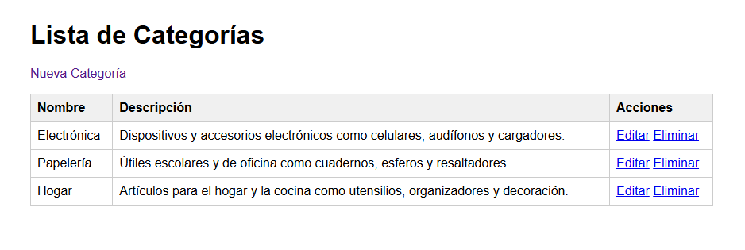
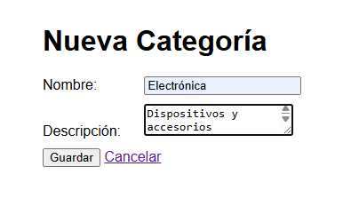
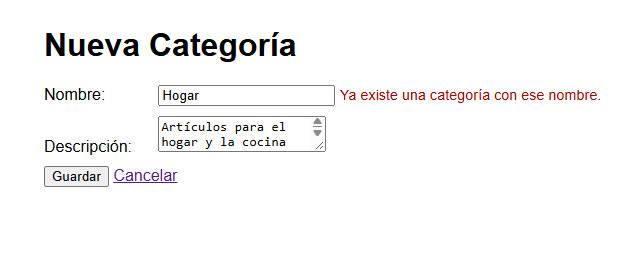
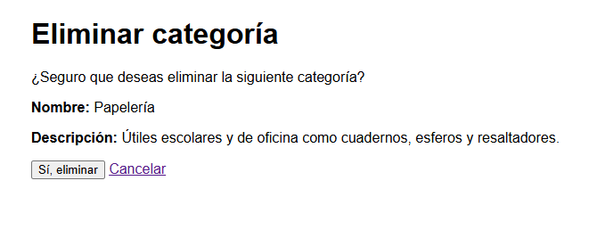
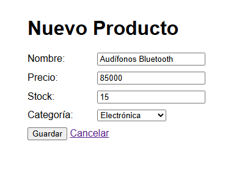
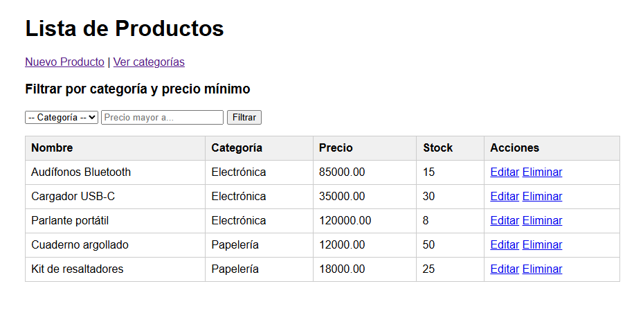
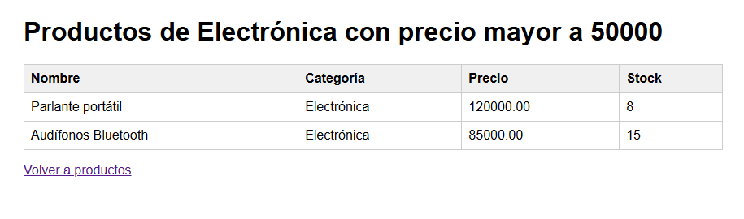
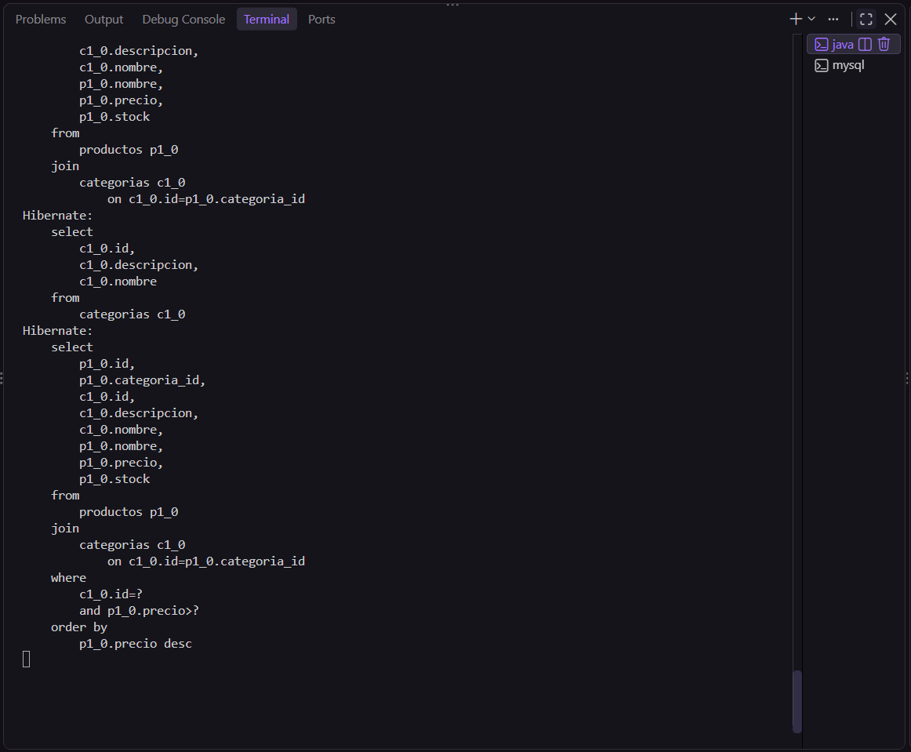
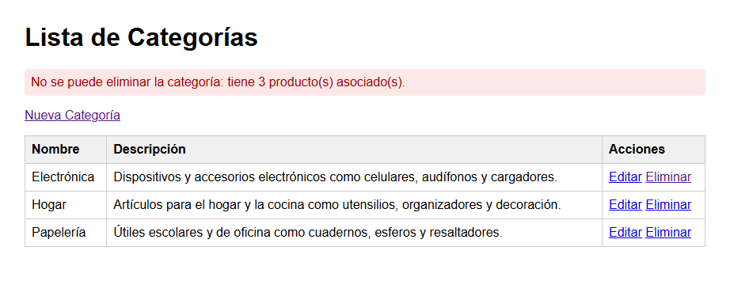

# Post-contenido — Unidad 8: Persistencia con JPA/Hibernate

## Descripción

Repositorio del laboratorio de la Unidad 8 de Programación Web — Séptimo Semestre.
Contiene un único proyecto Maven Spring Boot (`catalogo-jpa/`) con un CRUD de
categorías usando Spring Data JPA e Hibernate contra MySQL, y su extensión con la
entidad `Producto` y una relación `@ManyToOne`/`@OneToMany` hacia `Categoria`.

## Parte 1 — CRUD de Categoría con JPA/Hibernate y MySQL

`CategoriaController`, `CategoriaService` y `CategoriaRepository` (`JpaRepository`)
gestionan la entidad `Categoria`, persistida en MySQL mediante Hibernate. Incluye
listado, registro, edición y eliminación con validación de campos (`@NotBlank`,
`@Size`, nombre único) y plantillas Thymeleaf (`lista.html`, `formulario.html`,
`confirmar-eliminar.html`).

## Parte 2 — Relación @ManyToOne/@OneToMany con Producto

La entidad `Producto` agrega la relación `@ManyToOne` hacia `Categoria` (columna
`categoria_id`, `FetchType.LAZY` explícito), con el lado inverso `@OneToMany` en
`Categoria`. `ProductoRepository` expone `buscarPorCategoriaConPrecioMayorA`, una
consulta JPQL personalizada con `@Query` y `JOIN FETCH` que retorna los productos de
una categoría con precio mayor a un valor dado en una sola sentencia SQL.

### Diagrama de la relación Categoria–Producto

```
+---------------------+ 1                  N +----------------------+
|      Categoria      |-----------------------|       Producto       |
+---------------------+                       +----------------------+
| id (PK)             |  @OneToMany           | id (PK)              |
| nombre (único)      |  (mappedBy)           | nombre               |
| descripcion         |<----------------------| precio               |
| productos (List)    |   @ManyToOne (LAZY)   | stock                |
+---------------------+   @JoinColumn         | categoria_id (FK)    |
     lado inverso         lado propietario --->| categoria            |
                                              +----------------------+
```

## Funcionalidades implementadas

- CRUD completo de categorías (listar, crear, editar, eliminar con confirmación).
- Validación con Bean Validation y mensajes en el formulario sin perder los datos escritos.
- Verificación de nombre de categoría único antes de guardar (mensaje legible).
- CRUD completo de productos (listar con su categoría, crear, editar, eliminar).
- Consulta JPQL personalizada: productos de una categoría con precio mayor a un valor.
- Rechazo de la eliminación de una categoría que tiene productos asociados.
- Listado de productos con `JOIN FETCH` para evitar el problema N+1.

## Configuración de la base de datos

1. Crear la base de datos y el usuario en MySQL:

   ```sql
   CREATE DATABASE catalogo_db CHARACTER SET utf8mb4 COLLATE utf8mb4_unicode_ci;
   CREATE USER 'appuser'@'localhost' IDENTIFIED BY 'apppass';
   GRANT ALL PRIVILEGES ON catalogo_db.* TO 'appuser'@'localhost';
   FLUSH PRIVILEGES;
   ```

2. Configurar `catalogo-jpa/src/main/resources/application.properties` con la URL,
   usuario y contraseña de MySQL:

   ```properties
   spring.datasource.url=jdbc:mysql://localhost:3306/catalogo_db?useSSL=false&allowPublicKeyRetrieval=true&serverTimezone=UTC
   spring.datasource.username=appuser
   spring.datasource.password=apppass
   spring.jpa.hibernate.ddl-auto=update
   spring.jpa.show-sql=true
   ```

## Decisiones de diseño

- **`ddl-auto=update` en lugar de `create`:** conserva los datos de prueba entre
  reinicios mientras se agregaban las entidades de ambas partes. En producción se
  usaría `validate` o `none`.
- **Nombre único en `Categoria`:** se valida en `CategoriaService` antes de guardar,
  con un mensaje de error legible en el formulario, además de `unique = true` en la columna.
- **`FetchType.LAZY` explícito en `Producto.categoria`:** por defecto `@ManyToOne` es
  EAGER; se cambia a LAZY para no cargar la categoría en cada acceso a un producto. Las
  vistas que sí necesitan el nombre de la categoría usan `JOIN FETCH` explícito en el
  repositorio, lo que evita tanto la `LazyInitializationException` como el problema N+1.
- **Sin `cascade = REMOVE` de `Categoria` hacia `Producto`:** eliminar una categoría con
  productos asociados se rechaza explícitamente en el servicio en lugar de borrar los
  productos en cascada, priorizando la integridad de los datos del catálogo.
- **Método helper `asignarCategoria` en `Producto`:** mantiene sincronizados ambos lados
  de la relación bidireccional desde la entidad propietaria.
- **Inyección por constructor** y arquitectura en capas (controller / service / repository / model).

## Cómo compilar y ejecutar

1. Clonar el repositorio: `git clone https://github.com/diegoalferez/Alferez-post1-u8.git`
2. Crear la base de datos `catalogo_db` en MySQL (ver arriba).
3. Configurar `catalogo-jpa/src/main/resources/application.properties` con las credenciales de MySQL.
4. Ejecutar dentro de `catalogo-jpa/`:
   - Windows (PowerShell): `.\mvnw.cmd spring-boot:run`
   - Linux/macOS: `./mvnw spring-boot:run`
5. Parte 1: abrir http://localhost:8080/categorias
   Parte 2: abrir http://localhost:8080/productos

## Capturas de pantalla

### Parte 1 — CRUD de categorías

Lista de categorías:



Formulario de categoría (crear/editar):



Error de nombre duplicado:



Confirmación de eliminación:



### Parte 2 — Productos y consulta filtrada

Formulario de producto:



Lista de productos con su categoría:



Productos filtrados por categoría y precio (consulta JPQL):



SQL con un único JOIN en la consola:



Rechazo de eliminación de una categoría con productos:


